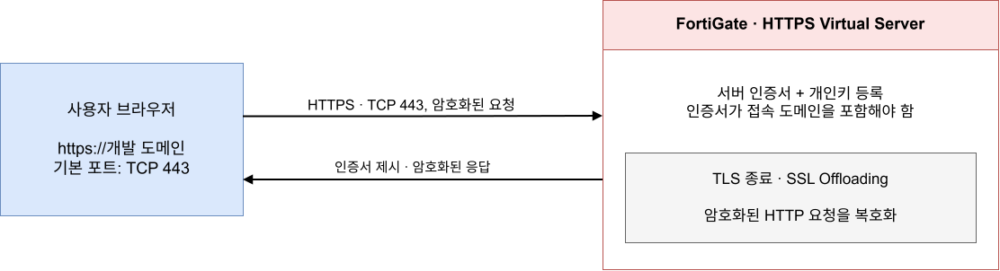
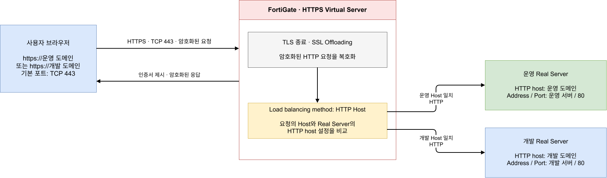
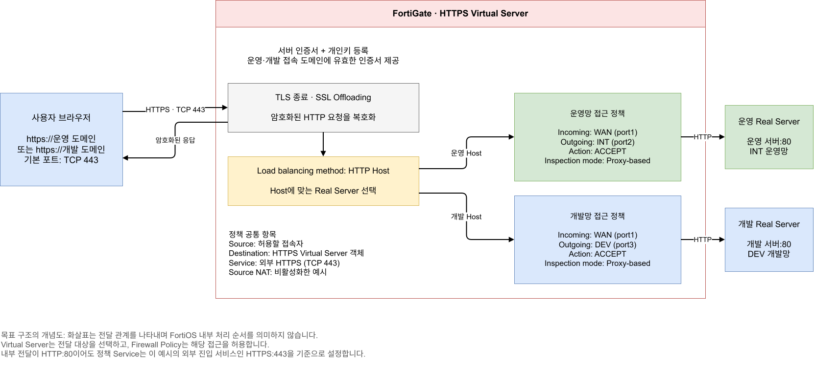
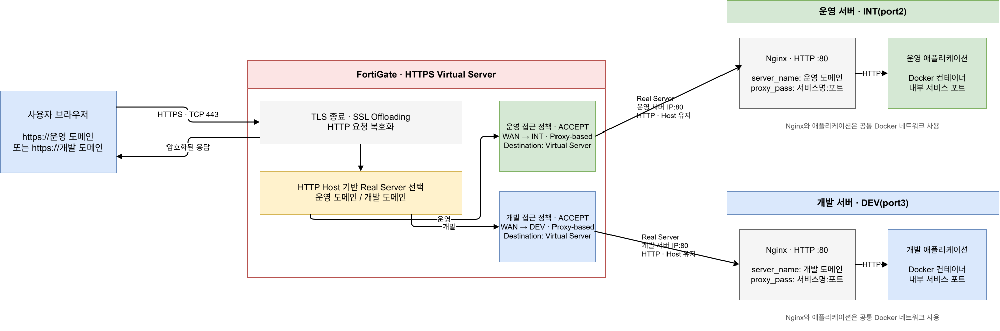

# FortiGate의 HTTPS 처리 흐름: TLS 종료부터 Nginx 전달까지

*공인 IP 하나에서 운영·개발 요청을 나누는 과정을 그림으로 정리한다.*

## 들어가며: 개발 서버에도 HTTPS를 적용하려고 한다

개발 서버의 접속 환경도 운영과 비슷하게 맞추려고 한다. 통신 방식에 따라 보안 설정과 애플리케이션 동작 조건이 달라질 수 있어, 개발 환경에서도 HTTPS를 사용할 필요가 생겼다.

문제는 운영·개발 서버가 공인 IP 하나를 함께 사용한다는 점이다. 두 도메인을 서로 다른 이름으로 만들어도 외부 HTTPS 요청은 같은 공인 IP의 `443` 포트에 도착한다. 개발 서버에 인증서를 설치하는 것에 더해, 이 요청을 어느 서버로 보낼지도 정해야 한다.

별도의 Nginx를 공통 진입점으로 두고 요청을 나누는 방법도 있다. 다만 현재는 온프레미스 환경이고, 스위치의 여유 포트와 서버 자원에 제약이 있어 새 구성을 추가하기가 부담스럽다. 여기서는 기존 FortiGate에서 HTTPS를 받은 뒤 운영·개발 서버로 나누는 방법을 살펴본다.

아래 그림은 검토 중인 구성이다. 외부 HTTPS 요청이 FortiGate를 지나 내부 애플리케이션에 도착하기까지, 각 단계가 무슨 일을 하는지 정리한다.

## 1. HTTPS를 받는 FortiGate가 인증서도 제공한다



먼저 바뀌는 것은 **TLS 연결을 처리하는 위치**다. 기존처럼 내부 Nginx가 HTTPS를 받는다면 Nginx가 인증서와 개인키를 사용한다. 반면 그림에서는 FortiGate가 사용자와 TLS 연결을 맺는다.

사용자는 운영 또는 개발 도메인으로 접속하지만, 인증서를 제공하는 쪽은 FortiGate다. 따라서 FortiGate에서 접속 도메인에 유효한 서버 인증서와 그에 대응하는 개인키를 사용할 수 있어야 한다.

FortiGate는 TLS 연결을 종료하고, 암호화되어 있던 HTTP 요청을 읽어 내부로 전달한다. 이처럼 HTTPS 처리를 앞단에서 맡는 구성을 **SSL Offloading**이라고 한다. 그림에서는 FortiGate 이후 구간을 HTTP로 전달한다. 내부 구간까지 TLS를 사용하는 구성과는 구분한다.

### 인증서 갱신도 함께 옮겨 생각해야 한다

HTTPS를 FortiGate에서 받게 되면 인증서를 관리할 위치도 달라진다. 기존 서버에서 Certbot으로 인증서를 갱신해도, 그 결과가 FortiGate에 반영되지 않으면 사용자는 계속 이전 인증서를 받는다.

따라서 발급 방법뿐 아니라 **갱신한 인증서를 FortiGate에 반영하는 방법**까지 정해야 한다. FortiGate 자체의 자동 갱신 기능을 이용하는 방법과 외부에서 갱신한 인증서를 가져오는 방법을 검토할 수 있다. 자체 자동 갱신을 지원하지 않는다는 이유만으로 이 구성이 불가능한 것은 아니지만, 수동 관리가 필요한지 자동 반영이 가능한지는 확인해야 한다.

이 부분은 장비 모델과 FortiOS 버전, 도메인 인증 조건에 따라 달라진다. 현재 글에서는 갱신 자동화가 준비된 것으로 가정하지 않는다. [Fortinet 인증서 가져오기 안내](https://docs.fortinet.com/document/fortigate/7.4.10/administration-guide/907098/import-a-certificate)

## 2. Virtual Server가 도메인에 맞는 서버를 고른다



FortiGate에서 HTTPS 요청을 받았다면, 이제 운영 서버로 보낼지 개발 서버로 보낼지 선택해야 한다. 이 역할을 맡는 것이 **Virtual Server**다. 여기서 Virtual Server는 VM 한 대가 아니라 FortiGate에 만드는 논리적인 접속 지점이다. 그 뒤에 연결할 내부 목적지는 **Real Server**로 등록한다.

이 구성의 선택 기준은 HTTP 요청에 들어 있는 **Host 헤더**다. Host에는 사용자가 요청한 도메인이 담겨 있다. HTTPS에서는 이 정보도 암호화되어 있으므로, 그림처럼 FortiGate가 TLS를 종료한 뒤 읽는다.

Virtual Server의 Load balancing method를 `HTTP Host`로 지정하고, Real Server에 다음 대응 관계를 등록한다.

| 설정 항목 | 의미 |
| --- | --- |
| `HTTP host` | 어떤 도메인으로 들어온 요청인지 구분한다. |
| `Address` | 요청을 보낼 내부 서버 IP를 지정한다. |
| `Port` | 내부 서버가 요청을 받을 포트를 지정한다. |

운영 도메인에 해당하면 운영 서버로, 개발 도메인에 해당하면 개발 서버로 전달하는 식이다. DNS가 도메인을 공인 IP로 연결하고, Virtual Server는 그 입구에 도착한 요청을 내부 목적지로 연결한다. 도메인을 DNS에 등록하는 것만으로 이 분기까지 만들어지는 것은 아니다.

그림에서 Real Server의 포트가 `80`인 이유는 FortiGate가 내부 Nginx로 HTTP 요청을 보내기 때문이다. 사용자가 접속하는 외부 구간은 여전히 HTTPS다. [Fortinet Virtual Server 안내](https://docs.fortinet.com/document/fortigate/7.4.0/administration-guide/713497/virtual-server-load-balance)

## 3. 방화벽 정책에서 해당 Virtual Server를 허용한다



요청의 목적지를 정했다고 통신이 허용되는 것은 아니다. Virtual Server가 어디로 전달할지를 정한다면, 방화벽 정책은 어떤 출발지와 서비스의 통신을 허용할지 정한다.

정책의 `Destination`에는 앞에서 만든 **HTTPS Virtual Server 객체**를 지정한다. 그림의 이 항목은 별도의 일반 VIP를 하나 더 만들라는 의미가 아니다. 이미 정의한 Virtual Server로 들어오는 요청을 정책에서 허용하는 것이다.

기존에 같은 공인 IP의 `443` 포트를 운영 서버로 보내는 VIP가 있다면 전환 방식도 함께 살펴봐야 한다. 내부 목적지가 다르더라도 외부에서 받는 주소와 포트가 겹칠 수 있기 때문이다. 기존 VIP를 유지한 채 새 객체만 추가하는 방식으로 처리할 수 있는지는 기존 설정과 대조해야 한다.

정책에서 Virtual Server를 선택할 수 있는 조건은 FortiOS 버전과 검사 모드에 따라서도 확인해야 한다. 이 글의 그림은 요청의 연결 관계를 설명하며, 실제 장비의 설정 항목을 모두 검증한 결과는 아니다.

## 4. Nginx가 서버 안의 애플리케이션으로 연결한다



FortiGate가 내부 서버를 골랐다면, 그다음은 서버 안에서 요청을 처리할 애플리케이션을 선택할 차례다. 이 역할은 Nginx가 맡는다.

Real Server에는 내부 서버의 IP와 Nginx의 수신 포트 `80`을 지정한다. Nginx는 전달받은 HTTP 요청을 `server_name`으로 구분하고, `proxy_pass`에 설정한 애플리케이션으로 보낸다. 요청을 대신 받아 내부 서비스로 전달하는 **리버스 프록시** 역할이다.

Nginx와 애플리케이션이 같은 Docker 네트워크에 연결되어 있다면 `컨테이너 이름:내부 포트`로 통신할 수 있다. 이때 사용하는 포트는 외부 사용자가 접속한 `443`이나 호스트에 공개한 포트와 구분해서 읽어야 한다.

전체 경로를 이어 보면 다음과 같다.

```text
사용자
  → HTTPS → FortiGate
              인증서 제공·TLS 종료
              Host를 기준으로 내부 서버 선택
  → HTTP → 선택된 서버의 Nginx
              server_name으로 요청 구분
              proxy_pass로 애플리케이션 연결
  → 애플리케이션
```

FortiGate는 공통 입구에서 내부 서버를 선택하고, Nginx는 그 서버 안의 애플리케이션을 선택한다. 따라서 개발 서버에 HTTPS를 적용하는 일도 인증서 설치 하나로 끝나지 않는다. TLS 처리 위치, 도메인별 전달 대상, 방화벽 정책, 내부 Nginx 연결을 함께 맞추는 작업이 된다.
